<!--
  The github.com/skyrowlabs org page. Its home is skyrowlabs/skyrowlabs.com,
  profile/README.md; .github/workflows/profile.yml builds it with
  scripts/profile_build.py and mirrors it into the public skyrowlabs/.github
  repo. Edit it there, never in skyrowlabs/.github.
  Copy markers are filled from README.md by scripts/copy.py; project markers
  become that repo's hero and badges at build time.
-->

  <a href="https://skyrowlabs.com"></a>

<h3 align="center"><!-- copy:site.tagline -->ai engineered awesomeness<!-- /copy --></h3>

<!-- copy:site.thesis -->Using AI and automation to design, build, and manage tools and tech for everyone<!-- /copy -->

  

---

  <a href="https://jamsense.ai"></a>

  
  
  
  

**<!-- copy:js.tagline -->Jam · Gain fame · Earn money<!-- /copy -->**

<!-- copy:js.short -->
A **platform for independent musicians** to build their brand, connect with fans, and perform live
<!-- /copy -->

---

  <a href="https://skyrowlabs.com"></a>

  
  
  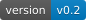
  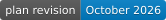
  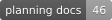
  

  
  
  
  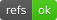
  
  

**<!-- copy:bb.tagline -->Wind powered · Air cooled · Zero water<!-- /copy -->**

<!-- copy:bb.short -->
A **low footprint, green compute and inference cluster**, powered by alternative energy, using **zero groundwater**.
<!-- /copy -->

---

  <a href="https://skyrowlabs.com"></a>

  
  
  

**<!-- copy:sf.tagline -->Catalogue · Ask · Retrieve<!-- /copy -->**

<!-- copy:sf.short -->
A **personal intelligence platform** — you choose what you track, and nothing reaches you that you didn't ask for.
<!-- /copy -->

---

  <a href="https://skyrowlabs.com"></a>

  
  
  

**<!-- copy:mh.tagline -->Your data · Your brain · Your choice<!-- /copy -->**

<!-- copy:mh.short -->
A **personal AI brain** — self-hosted, fine-tuned on your data, on transparent hardware you control. A personal digital assistant for your data.
<!-- /copy -->

---

  <a href="https://github.com/skyrowlabs/sky-boss"></a>

  
  
  
  
  

**<!-- copy:sb.tagline -->Command & conquer<!-- /copy -->**

<!-- copy:sb.short -->
A **controller for the whole agent system** — every agent, across every repo, run and watched from one place.
<!-- /copy -->

---

  <a href="https://github.com/skyrowlabs/skeletor"></a>

  
  
  
  
  

**<!-- copy:sk.tagline -->One command · Whole shell<!-- /copy -->**

<!-- copy:sk.short -->
A **project shell generator** — one command in a blank repo, and it governs itself from the first commit.
<!-- /copy -->

